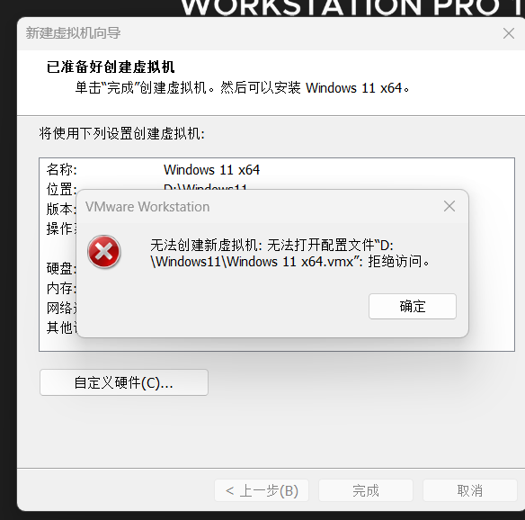
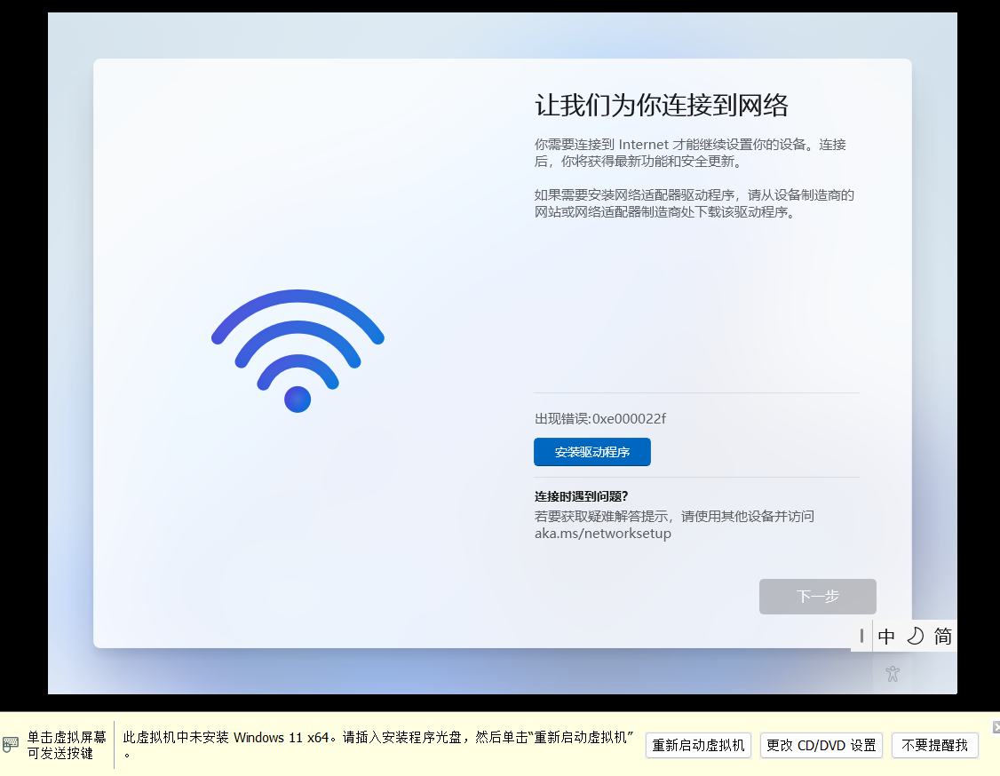

# vmware-win11-lab · VMware Workstation 部署 Windows 11 实战手册

[](LICENSE)


> 本仓库仅提供部署教程与配置文档，不含任何 Windows 镜像、产品密钥或授权手段；镜像请从微软官方网站获取。
>
> 本文档基于一次完整的实机安装会话整理，所有步骤、参数、报错信息与修复命令均取自该会话的真实输出。
> 未在该会话中实际执行的备选做法，均已显式标注为「本项目未采用」，不与已验证步骤混淆。

---

## 目录

- [简介](#简介)
- [前置依赖 & 环境要求](#前置依赖--环境要求)
- [系统镜像准备](#系统镜像准备)
- [VMware 虚拟机创建与分步安装教程](#vmware-虚拟机创建与分步安装教程)
- [关键配置说明](#关键配置说明)
- [已知坑点 & 故障排查 Troubleshooting](#已知坑点--故障排查-troubleshooting)
- [安装后基础配置](#安装后基础配置)
- [许可证说明](#许可证说明)
- [贡献指南 Contributing](#贡献指南-contributing)
- [附录](#附录)
- [附录 B：仓库目录结构](#附录-b仓库目录结构)
- [附录 C：.gitignore](#附录-cgitignore)

---

## 简介

`vmware-win11-lab` 是一份面向**安全研究、渗透测试、恶意样本分析、软件兼容性验证**等场景的 VMware Workstation 环境搭建手册，目标是在宿主机上稳定复现一台用于隔离测试的 Windows 11 虚拟机。

**项目目标：**

| 目标 | 说明 |
|---|---|
| 可复现 | 所有配置以 `.vmx` 键值与命令行形式给出，不依赖界面记忆 |
| 可脚本化 | 使用 VMware 自带 `vmcli.exe` 建立并配置虚拟机，便于批量部署 |
| 真实排障 | 记录真实发生的报错、根因与修复命令，而非理想流程 |
| 合规 | 只提供部署教程，不涉及任何授权绕过手段 |

**适用场景：**

- 需要一台可随时快照、回滚的隔离 Windows 环境
- 需要在 Windows 11 上验证工具链、驱动、样本行为
- 需要与宿主机网络隔离（NAT / 仅主机）的测试环境

**文档约定：**

- `【VMware 操作步骤】`：在宿主机（VMware Workstation）侧执行
- `【Windows 安装步骤】`：在虚拟机内的 Windows 安装程序 / OOBE 中执行
- `<!-- Screenshot: xxx -->`：截图占位标记，可替换为实际图片
- 标注「本项目未采用」的内容为备选方案，仅供参考，未经本项目验证

---

## 前置依赖 & 环境要求

### 宿主机硬件（本项目实测环境）

| 项目 | 实测值 | 说明 |
|---|---|---|
| CPU | 13th Gen Intel Core i7-13650HX，14 核 20 线程 | 需支持并开启 Intel VT-x（AMD 平台对应 AMD-V） |
| 物理内存 | 23.8 GB | 分配给虚拟机 8 GB |
| 磁盘 | C: 210.5 GB（可用 71.8 GB）、D: 187.6 GB（可用约 121 GB）、E: 111.6 GB | 虚拟机位于 `D:\Windows11`，动态磁盘最大占用约 80 GiB |
| 网络 | Realtek RTL8852BE Wi-Fi 6（192.168.31.59/24，网关 192.168.31.1） | 有线网卡 Realtek PCIe GbE 未连接，全部走无线 |
| 宿主系统 | Windows 11 家庭版中国版 25H2，Build 26200.9457 | — |

> 注：本机注册表 `ProductName` 显示为 `Windows 10 Home China`，但 `CurrentBuild = 26200`，实际为 Windows 11 25H2。该字段为就地升级遗留，不影响使用。

### CPU 虚拟化开启条件

- 必须在 BIOS/UEFI 中开启 **Intel VT-x** / **AMD-V**，否则虚拟机无法启动或性能极低。
- 检查方式：

```powershell
Get-CimInstance Win32_Processor | Select-Object Name, VirtualizationFirmwareEnabled, SecondLevelAddressTranslationExtensions
```

- 图形化确认：任务管理器 → 性能 → CPU → 查看「虚拟化：已启用」。
- 若宿主机启用了 Hyper-V / WSL2 / 内核隔离（内存完整性），Workstation 17.x 可与之共存，但性能会下降。

### 软件版本要求

| 组件 | 本项目实测版本 |
|---|---|
| VMware Workstation Pro | **17.6.2 build-24409262** |
| 虚拟机硬件版本 | `virtualHW.version = "21"` |
| 客户机类型 | `guestOS = "windows11-64"` |
| 安装路径 | **`D:\`（非默认路径）** |

> **重要**：本项目将 VMware Workstation 安装在 `D:\`（盘根目录，非默认路径），因此可执行文件位于 `D:\vmware.exe`、`D:\vmcli.exe` 等。
> VMware 默认安装路径为 `C:\Program Files (x86)\VMware\VMware Workstation\`，请按实际路径替换下文命令。

安装目录下与本项目相关的工具：

| 工具 | 用途 |
|---|---|
| `vmware.exe` | 图形界面主程序 |
| `vmcli.exe` | 命令行创建 / 配置 / 查询虚拟机 |
| `vmrun.exe` | 虚拟机运行时操作（需 VMware Tools + 客户机凭据） |
| `vmware-vdiskmanager.exe` | 虚拟磁盘创建、扩展、碎片整理 |
| `vnetlib64.exe` | 虚拟网络安装库（供安装程序调用，非独立工具） |
| `vmnetcfg.exe` | 虚拟网络编辑器 |

<!-- Screenshot: VMware Workstation 17.6.2 关于对话框 -->

---

## 系统镜像准备

### 官方获取渠道

| 渠道 | 地址 | 说明 |
|---|---|---|
| Windows 11 官方下载页 | https://www.microsoft.com/software-download/windows11 | 提供官方 ISO 与媒体创建工具 |
| Windows 11 企业版评估版 | https://www.microsoft.com/evalcenter/download-windows-11-enterprise | 官方 90 天免费评估版，功能与企业版一致 |
| Microsoft Evaluation Center 总入口 | https://www.microsoft.com/evalcenter | 其他评估版镜像 |

**本项目的镜像获取渠道仅为微软官方网站。** 下方文件名与大小为本项目实测记录，仅用于核对文件是否完整：

```text
文件名：Windows11_Client_x64_zh-cn_26300_9457.iso
大小　：9,112,440,832 字节（约 8.49 GiB）
```

> 请勿从非官方渠道获取镜像。若镜像来源无法溯源，即使文件可正常启动，也不应作为可复现环境的基础。

### SHA256 校验

```powershell
Get-FileHash -Algorithm SHA256 "D:\Windows11\Windows11_Client_x64_zh-cn_26300_9457.iso" | Format-List
```

或使用系统自带工具：

```cmd
certutil -hashfile "D:\Windows11\Windows11_Client_x64_zh-cn_26300_9457.iso" SHA256
```

将输出与微软官方公布的哈希值**逐位比对**，不一致则镜像不可用。

> 本项目会话中仅校验了镜像可读性（成功读取文件头 2048 字节）并记录了文件大小，**未记录哈希值**。请以微软官方公布值为准。
<!-- Screenshot: ISO 的 SHA256 校验输出 -->

### 满足 Windows 11 硬件要求的两种做法

Windows 11 要求 TPM 2.0、UEFI 安全启动与最低内存。在 VMware 环境下有两种处理方式，本项目推荐第一种。

#### 方案一（推荐，本项目采用）：启用 VMware 自带的虚拟 TPM 2.0

| 要求 | 本项目做法 | 对应配置 |
|---|---|---|
| TPM 2.0 | 由 Workstation 自动添加**虚拟 TPM 2.0** | `managedVM.autoAddVTPM = "software"` |
| 安全启动 / UEFI | 使用 **UEFI 固件** | `firmware = "efi"` |
| 客户机类型 | 声明为 Windows 11 | `guestOS = "windows11-64"` |

实测结果：首次开机后，`.vmx` 中被 Workstation 自动写入：

```text
vtpm.present = "TRUE"
vtpm.ekCSR   = "MIIDbjCCAlYCAQAwSDEWMBQGBWeBBQIBDAtpZDo1NjRENTcwMDEW..."
vtpm.ekCRT   = "MIIEPjCCAyagAwIBAgIBATANBgkqhkiG9w0BAQsFADBIMRYwFAYFZ4EF..."
```

因此 Windows 11 安装程序**不会**出现「此电脑不满足 Windows 11 系统要求」。

**代价**：添加虚拟 TPM 会强制启用**虚拟机加密**（详见[关键配置说明 → vTPM 与加密](#vtpm-与加密)）。

#### 方案二（备选，本项目未采用）：安装程序内的注册表绕过

若不启用虚拟 TPM，可在 Windows 安装程序界面绕过硬件检查：

【Windows 安装步骤】

1. 在出现「此电脑不满足 Windows 11 系统要求」提示时，按 `Shift + F10` 调出命令提示符
2. 依次执行以下命令，创建 `LabConfig` 注册表项：

```cmd
reg add "HKLM\SYSTEM\Setup\LabConfig" /v BypassTPMCheck       /t REG_DWORD /d 1 /f
reg add "HKLM\SYSTEM\Setup\LabConfig" /v BypassSecureBootCheck /t REG_DWORD /d 1 /f
reg add "HKLM\SYSTEM\Setup\LabConfig" /v BypassRAMCheck        /t REG_DWORD /d 1 /f
```

3. 关闭命令提示符，返回上一页后重新点击 **下一步**，即可继续安装

> 该方案仅影响当前安装会话的硬件检查，**不改变系统后续的安全基线**：安装完成后的设备仍不具备 TPM 与安全启动能力，部分依赖这些能力的功能（如基于虚拟化的安全特性）将不可用。
> 本项目**未采用**此方案，步骤未在本项目环境中验证。

---

## VMware 虚拟机创建与分步安装教程

以下流程分为**命令行方式（本项目实际采用）**与**图形界面方式（等价操作）**两条路线，任选其一即可。

### 总览：本项目虚拟机配置清单

| 配置项 | 值 |
|---|---|
| 虚拟机名称 | `Windows 11 x64` |
| 存放目录 | `D:\Windows11` |
| 配置文件 | `D:\Windows11\Windows 11 x64.vmx` |
| 系统磁盘 | `D:\Windows11\Windows 11 x64.vmdk`（80 GiB，动态分配） |
| 固件 | UEFI（`firmware = "efi"`） |
| 虚拟 TPM | vTPM 2.0（`managedVM.autoAddVTPM = "software"`） |
| 内存 | 8192 MB |
| CPU | 4 vCPU，`cpuid.coresPerSocket = "2"` |
| 磁盘控制器 | NVMe（`nvme0:0`） |
| 光驱 | SATA（`sata0:1`），挂载安装 ISO，开机连接 |
| 启动顺序 | `bios.bootOrder = "cdrom"` |
| 网络 | `ethernet0`，`e1000e`，NAT 模式 |

---

### 步骤 1【VMware 操作步骤】准备虚拟机目录与权限

创建虚拟机前，先确认目标目录对**当前用户**可写。本项目的 `D:\Windows11` 目录 ACL 为：

```text
D:\Windows11 BUILTIN\Administrators:(I)(OI)(CI)(F)
             Everyone:(I)(OI)(CI)(RX)
             NT AUTHORITY\SYSTEM:(I)(OI)(CI)(F)
```

若当前进程为非提权进程，有效权限仅剩 `Everyone:(RX)`，**无法写入 `.vmx`**，将直接导致[问题 1](#问题-1创建虚拟机报无法打开配置文件--vmx拒绝访问)。

授予当前账户 Modify 权限（需管理员权限执行）：

```powershell
# 以管理员身份运行 PowerShell
$target = 'D:\Windows11'
$sid    = ([Security.Principal.WindowsIdentity]::GetCurrent()).User.Value
icacls $target /grant "*${sid}:(OI)(CI)M"
```

`M`（Modify）包含创建 / 删除文件与文件夹、写入数据，不包含修改 ACL 与取得所有权的权利，是最小够用权限集。

> **注意**：本项目**只对 `D:\Windows11` 授权，未修改 `D:\` 根目录 ACL**。因为该 D 盘为保留的旧系统盘，根目录下存在 `Program Files`、`ProgramData`、`pagefile.sys` 等，保持原有严格权限。

配套脚本：[scripts/Repair-VMFolderACL.ps1](scripts/Repair-VMFolderACL.ps1)

<!-- Screenshot: icacls D:\Windows11 修复前后的权限对比 -->

---

### 步骤 2【VMware 操作步骤】创建虚拟机

#### 方式 A：命令行（本项目实际采用）

```powershell
# 创建虚拟机骨架：仅包含芯片组与基本设备，不含磁盘、光驱、固件与网卡
& 'D:\vmcli.exe' VM Create -n "Windows 11 x64" -d "D:\Windows11" -c windows11-64
```

输出：

```text
VMX file is created, filepath: D:\Windows11\Windows 11 x64.vmx
Virtual disk file creation is successful, filepath: D:\Windows11\Windows 11 x64.vmdk
```

> **关键提示**：`vmcli VM Create` 生成的 `.vmx` 仅 692 字节，**只有芯片组配置**，不含系统磁盘挂载、光驱、固件类型与网络适配器，这些必须手工补齐。该项目中正是因为遗漏网络适配器，导致后续 OOBE 卡在联网页（见[问题 2](#问题-2oobe-卡在让我们为你连接到网络错误-0xe000022f)）。

生成的初始 `.vmx` 内容：

```text
.encoding = "GBK"
config.version = "8"
virtualHW.version = "21"
guestOS = "windows11-64"
numvcpus = "2"
memsize = "4096"
memory.maxsize = "0"
nvram = "Windows 11 x64.nvram"
svga.present = "TRUE"
mks.enable3d = "TRUE"
pciBridge0.present = "TRUE"
pciBridge4.present = "TRUE"
pciBridge4.virtualDev = "pcieRootPort"
pciBridge4.functions = "8"
pciBridge5.present = "TRUE"
pciBridge5.virtualDev = "pcieRootPort"
pciBridge5.functions = "8"
pciBridge6.present = "TRUE"
pciBridge6.virtualDev = "pcieRootPort"
pciBridge6.functions = "8"
pciBridge7.present = "TRUE"
pciBridge7.virtualDev = "pcieRootPort"
pciBridge7.functions = "8"
vmci0.present = "TRUE"
hpet0.present = "TRUE"
```

#### 方式 B：图形界面（等价操作）

【VMware 操作步骤】

1. 启动 VMware Workstation，菜单 **文件 → 新建虚拟机**
2. 配置类型选择 **自定义（高级）**
3. 硬件兼容性选择 **Workstation 17.x**
4. 安装来源选择 **稍后安装操作系统**
5. 客户机操作系统选择 **Microsoft Windows**，版本选择 **Windows 11 x64**
6. 虚拟机名称填写 `Windows 11 x64`，位置填写 `D:\Windows11`
7. 固件类型选择 **UEFI**，并勾选 **安全启动**
8. 后续按[步骤 3](#步骤-3vmware-操作步骤创建虚拟磁盘)～[步骤 6](#步骤-6vmware-操作步骤配置网络适配器)填写磁盘、CPU、内存与网络
9. 在摘要页点击 **完成**

<!-- Screenshot: 新建虚拟机向导 - 固件类型选择 UEFI -->
<!-- Screenshot: 新建虚拟机向导 - 摘要页 -->

---

### 步骤 3【VMware 操作步骤】创建虚拟磁盘

本项目使用 **80 GiB 动态分配（growable）单文件磁盘** 作为系统盘。

```powershell
# 若已存在同名磁盘需先删除
Remove-Item 'D:\Windows11\Windows 11 x64.vmdk' -Force

& 'D:\vmcli.exe' Disk Create -f 'D:\Windows11\Windows 11 x64.vmdk' -a lsilogic -s 80GB -t 0
```

参数说明：

| 参数 | 值 | 含义 |
|---|---|---|
| `-f` | `D:\Windows11\Windows 11 x64.vmdk` | 磁盘文件完整路径 |
| `-a` | `lsilogic` | 适配器类型（SATA / NVMe / SCSI 均传 `lsilogic`） |
| `-s` | `80GB` | 容量 |
| `-t` | `0` | 磁盘类型：单一动态增长磁盘 |

磁盘类型对照：

| `-t` | 类型 |
|---|---|
| 0 | 单一动态增长磁盘（growable） |
| 1 | 动态增长磁盘，拆分为多个文件 |
| 2 | 预分配磁盘 |
| 3 | 预分配磁盘，拆分为多个文件 |

创建完成后，`.vmdk` 描述文件中应包含：

```text
# Disk DescriptorFile
version=1
encoding="GBK"
CID=fffffffe
parentCID=ffffffff
createType="monolithicSparse"

# Extent description
RW 167772160 SPARSE "Windows 11 x64.vmdk"

# The Disk Data Base
#DDB
ddb.adapterType = "lsilogic"
ddb.geometry.cylinders = "10443"
ddb.geometry.heads = "255"
ddb.geometry.sectors = "63"
ddb.virtualHWVersion = "14"
```

> `RW 167772160 SPARSE` × 512 字节 = 85,899,345,920 字节 = **80 GiB**，可据此确认容量正确。
> 动态磁盘初始文件仅约 10 MB，随实际写入增长。

在图形界面方式下，等效操作为：向导「磁盘容量」填写 `80.0 GB`，勾选 **将虚拟磁盘拆分成多个文件**（不勾选即为单文件）。

<!-- Screenshot: 向导中的磁盘容量与类型设置 -->

---

### 步骤 4【VMware 操作步骤】补齐 .vmx 配置

以下命令全部使用 `vmcli` 的 `ConfigParams SetEntry` 子命令，语法为：

```text
vmcli.exe <vmx 路径> ConfigParams SetEntry <键名> <值>
```

**固件、TPM、CPU 与内存：**

```powershell
$vmcli = 'D:\vmcli.exe'
$vmx   = 'D:\Windows11\Windows 11 x64.vmx'

# 固件类型：UEFI
& $vmcli $vmx ConfigParams SetEntry firmware efi

# 让 Workstation 在首次开机时自动添加虚拟 TPM 2.0
& $vmcli $vmx ConfigParams SetEntry managedVM.autoAddVTPM software

# 内存 8192 MB
& $vmcli $vmx ConfigParams SetEntry memsize 8192

# 4 vCPU，每插槽 2 核
& $vmcli $vmx ConfigParams SetEntry numvcpus 4
& $vmcli $vmx ConfigParams SetEntry cpuid.coresPerSocket 2
```

**系统磁盘挂载（NVMe 控制器）：**

```powershell
& $vmcli $vmx ConfigParams SetEntry nvme0.present        TRUE
& $vmcli $vmx ConfigParams SetEntry 'nvme0:0.present'    TRUE
& $vmcli $vmx ConfigParams SetEntry 'nvme0:0.deviceType' disk
& $vmcli $vmx ConfigParams SetEntry 'nvme0:0.fileName'   'Windows 11 x64.vmdk'
```

**光驱挂载安装镜像（SATA 控制器）：**

```powershell
$iso = 'D:\Windows11\Windows11_Client_x64_zh-cn_26300_9457.iso'

& $vmcli $vmx ConfigParams SetEntry sata0.present              TRUE
& $vmcli $vmx ConfigParams SetEntry 'sata0:1.present'          TRUE
& $vmcli $vmx ConfigParams SetEntry 'sata0:1.deviceType'       cdrom-image
& $vmcli $vmx ConfigParams SetEntry 'sata0:1.fileName'         $iso
& $vmcli $vmx ConfigParams SetEntry 'sata0:1.startConnected'   TRUE
```

**启动顺序与显示名：**

```powershell
& $vmcli $vmx ConfigParams SetEntry bios.bootOrder cdrom
& $vmcli $vmx ConfigParams SetEntry displayName   'Windows 11 x64'
```

**校验配置是否被正确解析：**

```powershell
& $vmcli $vmx ConfigParams query
```

配套脚本：[scripts/New-Win11VM.ps1](scripts/New-Win11VM.ps1)（将步骤 2–6 合并为一次执行）

---

### 步骤 5【VMware 操作步骤】CPU 与内存分配

| 项目 | 本项目取值 | 建议范围 | 说明 |
|---|---|---|---|
| 内存 `memsize` | 8192 MB | 4096–16384 MB | Windows 11 最低 4096 MB，实际使用建议 ≥ 8192 MB |
| vCPU `numvcpus` | 4 | 2–8 | 不超过物理核心数 |
| 每插槽核心 `cpuid.coresPerSocket` | 2 | 2 | 影响客户机识别的 NUMA 拓扑 |

宿主机实测可用内存 14.2 GB（总 23.8 GB）时分配 8 GB 是安全值。

---

### 步骤 6【VMware 操作步骤】配置网络适配器

本项目使用 **NAT 模式 + `e1000e` 网卡**。Windows 11 自带 `e1000e` 驱动程序，无需安装 VMware Tools 即可在 OOBE 阶段联网；`vmxnet3` 则需要 VMware Tools 提供驱动，不适合在安装阶段使用。

```powershell
& $vmcli $vmx ConfigParams SetEntry 'ethernet0.present'         TRUE
& $vmcli $vmx ConfigParams SetEntry 'ethernet0.virtualDev'      e1000e
& $vmcli $vmx ConfigParams SetEntry 'ethernet0.connectionType'  nat
& $vmcli $vmx ConfigParams SetEntry 'ethernet0.addressType'     generated
& $vmcli $vmx ConfigParams SetEntry 'ethernet0.startConnected'  TRUE
& $vmcli $vmx ConfigParams SetEntry 'ethernet0.displayName'     'Network Adapter'
```

首次开机后，Workstation 会自动补入以下键值：

```text
ethernet0.pciSlotNumber = "192"
ethernet0.generatedAddress = "00:0c:29:d7:cd:42"
ethernet0.generatedAddressOffset = "0"
```

> 若 `.vmx` 中完全没有 `ethernet0`，Windows 11 的 OOBE 会在联网页报 `0xe000022f` 并锁死「下一步」按钮，详见[问题 2](#问题-2oobe-卡在让我们为你连接到网络错误-0xe000022f)。

图形界面等效操作：向导「网络类型」选择 **使用网络地址转换（NAT）**。

---

### 步骤 7【VMware 操作步骤】开机并进入安装程序

```powershell
& 'D:\vmcli.exe' 'D:\Windows11\Windows 11 x64.vmx' Power Start
```

或在图形界面中点击 **开启此虚拟机**。

**首次开机时的预期行为：**

1. 由于启用了虚拟 TPM，Workstation 会要求为虚拟机**设置加密密码**。请务必牢记该密码——密码丢失后 vTPM 数据与虚拟机的加密配置将无法恢复。
2. UEFI 固件从光驱启动，加载 Windows 11 安装程序。
3. 记录到虚拟机日志中的正常启动标志：

```text
ConfigDB: Setting ethernet0.generatedAddress = <not printed>
Ethernet0 MAC Address: 00:0c:29:d7:cd:42
VNET: MACVNetConnectToNetwork 'ethernet0' lsp.state = 4
VNET: MACVNetLinkStateTimerHandler: 'ethernet0' state from 1 to 5
E1000: e1000e-- tx queue 1 is enabled.
```

<!-- Screenshot: EFI 从 ISO 启动，进入 Windows 安装程序 -->

---

### 步骤 8【Windows 安装步骤】执行 Windows 11 安装

> 以下步骤在虚拟机内的 Windows 安装程序中完成。

1. 选择语言、时间和货币格式、键盘输入法，点击 **下一步**
2. 点击 **现在安装**
3. 输入产品密钥步骤选择 **我没有产品密钥**
4. 选择要安装的操作系统版本，接受微软软件许可条款
5. 安装类型选择 **自定义：仅安装 Windows（高级）**
6. 磁盘选择列表中应出现一块约 **80 GB 的未分配空间**（对应 `nvme0:0`）。
   直接选中该未分配空间后点击 **下一步**，由安装程序自动创建分区。
   > 本项目**未手动分区**，未使用「新建 / 删除 / 格式化」按钮。
7. 开始复制文件并自动重启，期间无需干预

> 若磁盘列表中**看不到任何磁盘**，参见[问题 7](#问题-7虚拟磁盘无法识别)。

<!-- Screenshot: 安装类型选择界面 -->
<!-- Screenshot: 磁盘选择界面，显示 80 GB 未分配空间 -->

---

### 步骤 9【Windows 安装步骤】完成 OOBE 初始设置

1. **网络连接页**：确认出现 **网络 → 已连接**，且 **下一步** 按钮可用。
   若显示 `错误 0xe000022f` 或 **网络 / 无 Internet**，参见[问题 2](#问题-2oobe-卡在让我们为你连接到网络错误-0xe000022f)与[问题 3](#问题-3oobe-显示网络--无-internet错误-0x80070015)。
2. 按提示设置区域、键盘布局。
3. 账户设置：按界面提示完成账户配置。
   > 若安装介质强制要求联机账户，可在 OOBE 界面按 `Shift + F10` 打开命令提示符后自行处理。该做法本项目**未采用**，仅作备注。
4. 设置隐私选项后等待首次进入桌面。

OOBE 阶段客户机通过 DHCP 自动取得地址，实测记录：

```text
lease 192.168.139.130 {
    starts 6 2026/10/10 17:14:34;
    ends   6 2026/10/10 17:44:34;
    hardware ethernet 00:0c:29:d7:cd:42;
    uid 01:00:0c:29:d7:cd:42;
    client-hostname "Windows";
}
```

<!-- Screenshot: OOBE 网络页显示「网络 / 已连接」 -->
<!-- Screenshot: Windows 11 桌面 -->

---

## 关键配置说明

### UEFI 模式设置

| 项目 | 值 | 说明 |
|---|---|---|
| 固件类型 | `firmware = "efi"` | 对应图形界面「固件类型：UEFI」 |
| 安全启动 | Workstation 默认随 UEFI 启用 | Windows 11 的硬性要求之一 |
| EFI 变量存储 | `<虚拟机名>.nvram` | 本项目为 `Windows 11 x64.nvram`，约 2.3 MB |

**核对方法**：

```powershell
Select-String -Path 'D:\Windows11\Windows 11 x64.vmx' -Pattern 'firmware|nvram'
```

> 使用 UEFI 时，`bios.bootOrder` 对启动顺序的影响有限，实际启动顺序由 NVRAM 中的 EFI 启动项决定。

### vTPM 与加密

**启用方式：**

```powershell
& 'D:\vmcli.exe' 'D:\Windows11\Windows 11 x64.vmx' ConfigParams SetEntry managedVM.autoAddVTPM software
```

**开机后 Workstation 自动写入的加密相关键值（真实记录）：**

```text
vtpm.present            = "TRUE"
vtpm.ekCSR              = "MIIDbjCCAlYCAQAwSDEWMBQGBWeBBQIBDAtpZDo1NjRENTcwMDA..."
vtpm.ekCRT              = "MIIEPjCCAyagAwIBAgIBATANBgkqhkiG9w0BAQsFADBIMRYwFAYFZ4EF..."
encryption.keySafe      = "vmware:key/list/(pair/(phrase/...))"
encryption.encryptedKey = "AQAAANCMnd8BFdERjHoAwE/Cl+sBAAAA..."
encryption.data         = "AMDLCAY1kWpb7rcMC3YWYMSi4Dss7+M4Ol5aUNM1s87RM+nx..."
```

**必须了解的三个后果：**

1. 添加虚拟 TPM 会强制启用**虚拟机加密**，首次开机必须设置加密密码。
2. **加密密码丢失后，vTPM 数据不可恢复，虚拟机将无法启动**。请单独备份该密码。
3. 加密后的虚拟机，使用命令行工具（如 `vmcli`）操作时会要求提供密码：

```text
vmcli.exe: Something went wrong while getting password from stdin.
```

**修改配置的注意事项：**

- 对已加密的虚拟机，**不要用工具重写整个 `.vmx`**，以免破坏其中的加密密钥与 vTPM 证书。
- 推荐做法是**追加写入**（`[IO.File]::AppendAllText`），只增加新键值，不改动既有行：

```powershell
$vmx   = 'D:\Windows11\Windows 11 x64.vmx'
$block = @(
    'ethernet0.present = "TRUE"',
    'ethernet0.virtualDev = "e1000e"',
    'ethernet0.connectionType = "nat"',
    'ethernet0.addressType = "generated"',
    'ethernet0.startConnected = "TRUE"'
) -join "`r`n"

Copy-Item $vmx "$vmx.prenic-backup" -Force
[IO.File]::AppendAllText($vmx, "`r`n" + $block + "`r`n", [Text.Encoding]::ASCII)
```

> 追加前应先使用独占方式打开文件确认其未被占用（虚拟机必须处于关机状态）：

```powershell
$fs = [IO.File]::Open($vmx, 'Open', 'ReadWrite', 'None'); $fs.Close()
```

配套脚本：[scripts/Add-NicToVMX.ps1](scripts/Add-NicToVMX.ps1)

### 虚拟磁盘分区方案

本项目**未手动分区**。80 GiB 系统盘（`nvme0:0`）在安装时保持未分配状态，由 Windows 11 安装程序自动创建分区结构：

| 分区 | 类型 | 来源 |
|---|---|---|
| EFI 系统分区（ESP） | FAT32 | 安装程序自动创建 |
| MSR 微软保留分区 | 无文件系统 | 安装程序自动创建 |
| Windows 恢复分区 | NTFS | 安装程序自动创建 |
| 系统主分区（C:） | NTFS | 占剩余空间 |

**如需手动分区**：在磁盘选择界面使用 **新建**、**删除**、**格式化** 按钮自行规划。UEFI + GPT 环境下，Windows 11 要求至少存在一个 EFI 系统分区。

**验证分区结构**（在客户机内）：

```powershell
Get-Partition | Format-Table DiskNumber, PartitionNumber, DriveLetter, Size, Type
Get-Disk | Format-Table Number, PartitionStyle, Size, FriendlyName
```

> 系统盘为 **NVMe** 控制器。若需 SATA 控制器，可将 `nvme0:*` 键值替换为 `sata0:0.*`，并相应调整光驱占用槽位（避免与光驱冲突）。

### 虚拟机网络模式说明

| 模式 | 配置值 | 虚拟网络 | 客户机可见性 | 适用场景 |
|---|---|---|---|---|
| 桥接 | `connectionType = "bridged"` | vmnet0 | 与宿主机同网段，可被局域网其他设备直接访问 | 需要对外提供服务、渗透测试靶机 |
| NAT | `connectionType = "nat"` | vmnet8 | 通过宿主机转发，外网可出、外网不可直接入 | **本项目采用**，隔离性好且开箱即用 |
| 仅主机 | `connectionType = "hostonly"` | vmnet1 | 只能与宿主机通信，完全无外网 | 恶意样本分析、完全隔离测试 |

**本项目所在机器的虚拟网络实测状态：**

| 虚拟网络 | 用途 | 网段 | 网关 / DNS | DHCP 地址池 |
|---|---|---|---|---|
| vmnet0 | 桥接 | 由物理网卡自动桥接 | — | — |
| vmnet1 | 仅主机 | 初始 `192.168.31.0/24`，后调整为 **`192.168.70.0/24`** | 192.168.70.1 | 192.168.70.128–254 |
| vmnet8 | NAT | `192.168.139.0/24` | **192.168.139.2** | 192.168.139.128–254 |

**写入 `.vmx` 的 `connectionType` 取值对照：**

```text
ethernet0.connectionType = "nat"        # NAT（本项目）
ethernet0.connectionType = "bridged"    # 桥接
ethernet0.connectionType = "hostonly"   # 仅主机
ethernet0.connectionType = "custom"     # 自定义（需指定 ethernet0.vnet）
```

**网卡类型选择：**

| 虚拟网卡 | 驱动来源 | 能否在 OOBE 阶段联网 |
|---|---|---|
| `e1000e` | Windows 11 自带 | **可以**（本项目采用） |
| `vmxnet3` | 需安装 VMware Tools | 不可以 |

**检查 NAT 状态（宿主机侧）：**

```powershell
Get-Service 'VMware NAT Service', 'VMnetDHCP' | Select-Object Name, Status, StartType
Get-Process vmnat, vmnetdhcp -ErrorAction SilentlyContinue
Get-NetIPAddress -AddressFamily IPv4 | Where-Object { $_.InterfaceAlias -like '*VMnet*' }
```

**验证 NAT 是否正在转发客户机流量：**

```powershell
$vmnatPid = (Get-Process vmnat -ErrorAction SilentlyContinue).Id
(Get-NetTCPConnection -OwningProcess $vmnatPid |
    Where-Object State -eq 'Established').Count
```

若该计数大于 0，且远端地址为互联网地址，说明客户机流量正在被 NAT 转发。

---

## 已知坑点 & 故障排查 Troubleshooting

### 问题 1：创建虚拟机报「无法打开配置文件 ... .vmx：拒绝访问」

**现象**

```text
无法创建新虚拟机: 无法打开配置文件"D:\Windows11\Windows 11 x64.vmx": 拒绝访问。
```

**根因**

`D:\Windows11` 的 ACL 只包含 `BUILTIN\Administrators:(F)`、`Everyone:(RX)`、`NT AUTHORITY\SYSTEM:(F)`。
当前用户虽属于 Administrators 组，但 Workstation 以**非提权进程**运行，UAC 过滤令牌下 Administrators 权限被标记为仅拒绝，**有效权限只剩 `Everyone:(RX)`**，因此无法新建 `.vmx`。

**定位**

```powershell
# 1. 查看目录 ACL
icacls 'D:\Windows11'
icacls 'D:\'

# 2. 确认当前进程是否提权
([Security.Principal.WindowsPrincipal][Security.Principal.WindowsIdentity]::GetCurrent()
    ).IsInRole([Security.Principal.WindowsBuiltInRole]::Administrator)

# 3. 写入测试
[IO.File]::WriteAllText('D:\Windows11\__write_test.tmp','x')
```

实测输出：权限检查返回 `False`，写入测试抛出 `对路径"D:\Windows11\__write_test.tmp"的访问被拒绝`；对照 `E:\` 写入成功（其根目录含 `Authenticated Users:(M)`）。

**处理**

以管理员身份执行：

```powershell
$target = 'D:\Windows11'
$sid    = ([Security.Principal.WindowsIdentity]::GetCurrent()).User.Value
icacls $target /grant "*${sid}:(OI)(CI)M"
```

**验证**

修复后 ACL 变为：

```text
D:\Windows11 LAPTOP-485G0VPR\LEN:(OI)(CI)(M)
             BUILTIN\Administrators:(I)(OI)(CI)(F)
             Everyone:(I)(OI)(CI)(RX)
             NT AUTHORITY\SYSTEM:(I)(OI)(CI)(F)
```

以**非提权**身份复现向导的全部文件操作，六项全部通过：

| 操作 | 结果 |
|---|---|
| 创建虚拟机子目录 | OK |
| 写入 `.vmx` 配置 | OK |
| 追加修改 `.vmx` | OK |
| 创建稀疏 `.vmdk` | OK |
| 创建 `.lck` 锁定目录 | OK |
| 读取安装 ISO | OK（读取前 2048 字节） |

**备选方案**：以管理员身份运行 `vmware.exe`，可临时绕过该问题（不改变 ACL）。

配套脚本：[scripts/Repair-VMFolderACL.ps1](scripts/Repair-VMFolderACL.ps1)


<!-- Screenshot: icacls 修复前后的输出对比 -->

---

### 问题 2：OOBE 卡在「让我们为你连接到网络」，错误 `0xe000022f`

**现象**

Windows 11 OOBE 停留在「让我们为你连接到网络」页面，「下一步」按钮为灰色不可点击，页面显示：

```text
出现错误:0xe000022f
[安装驱动程序]
```

**根因**

`.vmx` 中**完全没有 `ethernet0` 配置**。`vmcli VM Create` 生成的骨架只含芯片组，不含网络适配器。
`0xe000022f` 表示系统找不到网络适配器，并非驱动损坏，点击「安装驱动程序」无法解决问题。

**定位**

```powershell
Select-String -Path 'D:\Windows11\Windows 11 x64.vmx' -Pattern 'ethernet|network|vmnet'
```

若无任何输出，即确认缺失网卡配置。

**处理**

虚拟机关机后，向 `.vmx` **追加**网卡配置（追加而非重写，避免影响已存在的加密密钥）：

```powershell
$vmx = 'D:\Windows11\Windows 11 x64.vmx'

# 确认虚拟机已关机且文件未被占用
do { Start-Sleep -Seconds 5 } while (Get-Process vmware-vmx -ErrorAction SilentlyContinue)

Copy-Item $vmx "$vmx.prenic-backup" -Force

$block = @(
    'ethernet0.present = "TRUE"',
    'ethernet0.virtualDev = "e1000e"',
    'ethernet0.connectionType = "nat"',
    'ethernet0.addressType = "generated"',
    'ethernet0.startConnected = "TRUE"',
    'ethernet0.displayName = "Network Adapter"'
) -join "`r`n"

[IO.File]::AppendAllText($vmx, "`r`n" + $block + "`r`n", [Text.Encoding]::ASCII)
```

**验证**

1. `.vmx` 中无重复键，Workstation 开机后自动补入 `ethernet0.pciSlotNumber`、`ethernet0.generatedAddress`。
2. 虚拟机日志出现：

```text
Ethernet0 MAC Address: 00:0c:29:d7:cd:42
VNET: MACVNetConnectToNetwork 'ethernet0' lsp.state = 4
E1000: e1000e-- tx queue 1 is enabled.
```

3. 客户机通过 DHCP 取得地址，宿主机租约文件中出现对应条目。

> 注意：若网卡已存在但地址未分配，页面会由 `0xe000022f` 变为 **网络 / 无 Internet**（错误码 `0x80070015`），此时应转向[问题 3](#问题-3oobe-显示网络--无-internet错误-0x80070015)。

配套脚本：[scripts/Add-NicToVMX.ps1](scripts/Add-NicToVMX.ps1)



---

### 问题 3：OOBE 显示「网络 / 无 Internet」，错误 `0x80070015`

**现象**

OOBE 页面已能识别网络设备（出现「网络」条目），但状态为 **无 Internet**，「下一步」仍不可用，错误码变为：

```text
出现错误:0x80070015
```

**根因**

**VMnet1（仅主机网络）的网段与物理局域网冲突。** 本机物理局域网为 `192.168.31.0/24`（网关 192.168.31.1），而 VMnet1 恰好也是 `192.168.31.0/24`（地址 192.168.31.1），导致路由表中出现一条更精确的 `/32` 路由，把发往 DNS 服务器的流量导向 VMnet1：

```text
目的地            接口                            度量
192.168.31.1/32   VMware Network Adapter VMnet1   256
0.0.0.0/0         192.168.31.1 （WLAN）           0
```

**为什么宿主机自己还能上网、而 NAT 转发失败：**

- Windows 解析器会把 DNS 查询**绑定到持有该 DNS 服务器的网卡**（即 WLAN），因此宿主机解析正常。
- VMware NAT 服务使用普通 socket，**按路由表选路**，于是被 `/32 → VMnet1` 截获，无法访问上游 DNS。
- 结果：客户机有 IP、有网关，但 DNS 不通，表现为「无 Internet」。

**定位**

```powershell
# 1. 查看到 DNS 服务器的路由
Get-NetRoute -AddressFamily IPv4 -DestinationPrefix '192.168.31.1/32'

# 2. 直连上游 DNS 服务器测试（NAT 服务走的正是这条路径）
nslookup www.msftconnecttest.com 192.168.31.1
```

修复前输出：`*** UnKnown can't find www.msftconnecttest.com: No response from server`

> **无效的测试方法**：从宿主机查询 NAT 网关的 DNS 代理（`nslookup <域名> 192.168.139.2`）**不会**得到响应——NAT 服务有意不处理宿主机自身发出的流量（`vmnetnat-mac.txt` 即用于识别宿主侧流量）。该测试不能用于判断 NAT 是否正常。

**处理方案 A（临时，重启后失效）：为上游 DNS 补一条高优先级路由**

```powershell
# 以管理员身份执行
$dns  = '192.168.31.1'
$wlan = Get-NetAdapter -Name 'WLAN'

New-NetRoute -DestinationPrefix "$dns/32" -InterfaceIndex $wlan.ifIndex `
             -NextHop '0.0.0.0' -RouteMetric 1 -PolicyStore ActiveStore

# 重启 VMware 虚拟网络服务，使 NAT 重新探测上游 DNS
Restart-Service 'VMnetDHCP' -Force
Restart-Service 'VMware NAT Service' -Force
```

> `-PolicyStore ActiveStore` 表示该路由**不持久化**，重启后消失。

**处理方案 B（根治，推荐）：修改 VMnet1 网段**

【VMware 操作步骤】

1. VMware Workstation → 菜单 **编辑 → 虚拟网络编辑器**
2. 点击 **更改设置**（触发 UAC 提权）
3. 选中 **VMnet1**，将 **子网 IP** 改为不与物理局域网冲突的网段，例如 `192.168.70.0`，掩码 `255.255.255.0`
4. 点击 **应用**

修改后 `vmnetdhcp.conf` 中对应段落同步更新：

```text
subnet 192.168.70.0 netmask 255.255.255.0 {
    range 192.168.70.128 192.168.70.254;
    option broadcast-address 192.168.70.255;
    option domain-name-servers 192.168.70.1;
}
host VMnet1 {
    hardware ethernet 00:50:56:C0:00:01;
    fixed-address 192.168.70.1;
}
```

**验证**

```powershell
nslookup www.msftconnecttest.com 192.168.31.1
Get-NetRoute -AddressFamily IPv4 -DestinationPrefix '192.168.31.1/32'
```

修复后：`nslookup` 正常返回解析结果；`/32` 路由不再指向 VMnet1。OOBE 页面由「无 Internet」变为 **网络 / 已连接**。

配套脚本：[scripts/Repair-VMnet1Conflict.ps1](scripts/Repair-VMnet1Conflict.ps1)（方案 A 的自动化版本）

<!-- Screenshot: OOBE 显示「网络 / 无 Internet」 -->
<!-- Screenshot: 虚拟网络编辑器 VMnet1 子网设置 -->
<!-- Screenshot: OOBE 显示「网络 / 已连接」 -->

---

### 问题 4：`vmcli Power Start` 报 `cannot connect to the virtual machine`

**现象**

```text
vmcli.exe: vmcli.exe cannot connect to the virtual machine. Make sure you have rights to
run the program, access all directories the program uses, and access all directories for
temporary files.
Communication with the VMX process has timed out.
```

`vmware-vmx.exe` 进程已启动，`vmware.log` 却停在配置加载阶段（最后一行类似 `ConfigDB: Setting virtualHW.productCompatibility = "hosted"`），设备始终未注册，且 `Power query` 报 `Device 'PowerState' is not available`。

**根因**

Workstation 主窗口被**模态对话框阻塞**。本例中「新建虚拟机向导」及其上的错误提示框使主窗口处于禁用状态，`vmware-vmx` 无法获得窗口而空等。

**定位**（枚举指定进程的所有顶层窗口，检查可见性与启用状态）：

```powershell
Add-Type -TypeDefinition @"
using System; using System.Text; using System.Runtime.InteropServices;
public class WinEnum {
  public delegate bool EnumProc(IntPtr h, IntPtr l);
  [DllImport("user32.dll")] public static extern bool EnumWindows(EnumProc cb, IntPtr l);
  [DllImport("user32.dll")] public static extern uint GetWindowThreadProcessId(IntPtr h, out uint pid);
  [DllImport("user32.dll",CharSet=CharSet.Unicode)] public static extern int GetWindowText(IntPtr h, StringBuilder s, int n);
  [DllImport("user32.dll",CharSet=CharSet.Unicode)] public static extern int GetClassName(IntPtr h, StringBuilder s, int n);
  [DllImport("user32.dll")] public static extern bool IsWindowVisible(IntPtr h);
  [DllImport("user32.dll")] public static extern bool IsWindowEnabled(IntPtr h);
  public static System.Collections.Generic.List<string> ForPid(uint target) {
    var res = new System.Collections.Generic.List<string>();
    EnumWindows((h,l) => {
      uint pid; GetWindowThreadProcessId(h, out pid);
      if (pid == target) {
        var t=new StringBuilder(512); GetWindowText(h,t,512);
        var c=new StringBuilder(256); GetClassName(h,c,256);
        res.Add(string.Format("visible={0} enabled={1} class={2} title={3}",
                 IsWindowVisible(h), IsWindowEnabled(h), c, t));
      }
      return true;
    }, IntPtr.Zero);
    return res;
  }
}
"@
[WinEnum]::ForPid((Get-Process vmware).Id)
```

实测输出中可见：

```text
visible=True  enabled=False class=#32770       title=新建虚拟机向导
visible=True  enabled=False class=VMUIFrame    title=VMware Workstation
```

主窗口 `enabled=False` 即为模态阻塞的直接证据。

**处理**

先处理掉当前挡在前面的模态对话框（例如取消向导）。若此时已有一个卡死的 `vmware-vmx.exe`，需先结束它（该进程以高完整性运行，需提权）：

```powershell
# 以管理员身份执行
Get-Process vmware-vmx -ErrorAction SilentlyContinue | Stop-Process -Force
Start-Sleep -Seconds 4
Get-ChildItem 'D:\Windows11' -Force -Directory -Filter '*.lck' |
    Remove-Item -Recurse -Force
```

配套脚本：[scripts/Stop-StuckVMX.ps1](scripts/Stop-StuckVMX.ps1)

<!-- Screenshot: Workstation 主窗口被模态向导阻塞 -->

---

### 问题 5：`vmcli Power Stop` 报 `getting password from stdin`

**现象**

```text
vmcli.exe: Something went wrong while getting password from stdin.
```

**根因**

虚拟机启用了虚拟 TPM，因此被**加密**。`vmcli` 操作运行中的加密虚拟机时必须提供加密密码。

**处理**

- 这是预期行为，不是故障。
- 需要操作时改用图形界面，由 Workstation 弹出密码输入框。
- **密码属于敏感信息，不应写入脚本、配置文件或提交到仓库。**

---

### 问题 6：提权的 `vmware-vmx.exe` 无法结束（Access denied）

**现象**

```text
Stop-Process : 由于以下错误而无法停止进程"vmware-vmx (xxxx)": Access is denied
taskkill : ERROR: The process with PID xxxx could not be terminated. Reason: Access is denied.
```

**根因**

`vmware-vmx.exe` 由 VMware 授权服务以**高完整性（提权）**身份启动，非提权进程无权结束它。

**处理**

以管理员身份执行结束操作：

```powershell
Get-Process vmware-vmx -ErrorAction SilentlyContinue |
    ForEach-Object { Stop-Process -Id $_.Id -Force }
```

随后清理残留的锁定目录：

```powershell
Get-ChildItem 'D:\Windows11' -Force -Directory -Filter '*.lck' |
    ForEach-Object { Remove-Item $_.FullName -Recurse -Force }
```

配套脚本：[scripts/Stop-StuckVMX.ps1](scripts/Stop-StuckVMX.ps1)

---

### 问题 7：虚拟磁盘无法识别

**现象**：Windows 安装程序的磁盘列表中看不到任何可用磁盘。

**本项目相关的成因与排查方向**：

1. **磁盘未挂载到 `.vmx`**。`vmcli VM Create` 只创建了 `.vmdk` 文件，**不会**自动写入挂载配置。检查：

```powershell
Select-String -Path 'D:\Windows11\Windows 11 x64.vmx' -Pattern 'nvme0|sata0|scsi0'
```

需要存在完整的挂载键值：

```text
nvme0.present = "TRUE"
nvme0:0.present = "TRUE"
nvme0:0.deviceType = "disk"
nvme0:0.fileName = "Windows 11 x64.vmdk"
```

2. **磁盘文件路径不正确**。`fileName` 为相对路径时相对于 `.vmx` 所在目录，确认 `D:\Windows11\Windows 11 x64.vmdk` 存在且可读。
3. **磁盘已被占用**。若上一次安装异常中断，虚拟机目录下可能残留 `*.lck` 目录，需在虚拟机关机后清除。

---

### 问题 8：重启后客户机仍无 Internet —— NAT 服务被禁用、配置被清空

**现象**

宿主重启后，客户机可取得 IP，但依然无法访问互联网。

**根因**

虚拟网络编辑器的一次操作把 **vmnet8 的网络类型定义一并重置**，产生连锁后果：

| 受损项 | 表现 |
|---|---|
| `VMware NAT Service` | 启动类型被改为 `Disabled`（`Start=4`），服务未运行 |
| `C:\ProgramData\VMware\vmnetnat.conf` | 文件不存在 |
| 注册表 `...\VMnetConfig\vmnet8` | 仅剩 `DisplayName`，`IPSubnetAddress` / `NAT\UseNAT` / `DHCP\UseDHCP` 全部丢失 |
| `netmap.conf` | `network8.name = "VMNet8"`（应为 `"NAT"`）、`network0.name = "VMNet0"`（应为 `"Bridged"`） |

**定位**

```powershell
Get-Service 'VMware NAT Service' | Select-Object Name, Status, StartType
Test-Path 'C:\ProgramData\VMware\vmnetnat.conf'
Get-ItemProperty 'HKLM:\SOFTWARE\WOW6432Node\VMware, Inc.\VMnetLib\VMnetConfig\vmnet8'
Select-String -Path 'C:\ProgramData\VMware\netmap.conf' -Pattern 'network0\.name|network8\.name'
```

**处理**

以管理员身份依次执行：

```powershell
# 1) 恢复 vmnet8 注册表配置
$k8 = 'HKLM:\SOFTWARE\WOW6432Node\VMware, Inc.\VMnetLib\VMnetConfig\vmnet8'
New-ItemProperty $k8 -Name 'IPSubnetAddress' -Value '192.168.139.0'   -PropertyType String -Force
New-ItemProperty $k8 -Name 'IPSubnetMask'    -Value '255.255.255.0'   -PropertyType String -Force
foreach ($p in @(@('NAT','UseNAT'), @('DHCP','UseDHCP'), @('Adapter','UseAdapter'))) {
    New-Item -Path (Join-Path $k8 $p[0]) -Force | Out-Null
    New-ItemProperty -Path (Join-Path $k8 $p[0]) -Name $p[1] -Value 1 -PropertyType DWord -Force | Out-Null
}

# 2) 重建 vmnetnat.conf
$natConf = 'C:\ProgramData\VMware\vmnetnat.conf'
$natText = @'
# Windows NAT configuration file

[host]
ip = 192.168.139.2/24
hostMAC = 00:50:56:C0:00:08
device = vmnet8
activeFTP = 1
allowAnyOUI = 1
resetConnectionOnLinkDown = 1
resetConnectionOnDestLocalHost = 1
natIp6Enable = 0

[tcp]
timeWaitTimeout = 30

[udp]
timeout = 30

[dns]
policy = order
timeout = 2
retries = 3
autodetect = 1

[netbios]
nbnsTimeout = 2
nbnsRetries = 3
nbdsTimeout = 3

[incomingtcp]

[incomingudp]

[PrivilegedTCP]
autodetect = 1

[PrivilegedUDP]
autodetect = 1
'@
[IO.File]::WriteAllText($natConf, $natText, [Text.Encoding]::ASCII)

# 3) NAT 服务恢复为自动启动
Set-Service -Name 'VMware NAT Service' -StartupType Automatic

# 4) 重建虚拟网络
& 'D:\vnetlib64.exe' -- stop
Start-Sleep -Seconds 5
& 'D:\vnetlib64.exe' -- start
Start-Sleep -Seconds 5

# 5) 修正 netmap.conf 中的网络类型名
$netmap = 'C:\ProgramData\VMware\netmap.conf'
$nm = Get-Content $netmap -Raw
$nm = $nm -replace 'network0\.name = "VMNet0"', 'network0.name = "Bridged"'
$nm = $nm -replace 'network8\.name = "VMNet8"', 'network8.name = "NAT"'
[IO.File]::WriteAllText($netmap, $nm, [Text.Encoding]::ASCII)

# 6) 启动服务
Start-Service 'VMnetDHCP'
Start-Service 'VMware NAT Service'
```

**验证**

```powershell
Get-Service 'VMware NAT Service' | Select-Object Status, StartType
Get-Process vmnat
$vmnatPid = (Get-Process vmnat).Id
(Get-NetTCPConnection -OwningProcess $vmnatPid | Where-Object State -eq 'Established').Count
Get-NetIPAddress -AddressFamily IPv4 | Where-Object { $_.InterfaceAlias -like '*VMnet*' }
```

实测结果：服务为 `Running / Automatic`，`vmnat` 进程存在，转发连接数 50+，VMnet8 = `192.168.139.1`，VMnet1 = `192.168.70.1`。

> **关于 `vnetlib64.exe`**：该工具的输出中包含 `this utility is not intended to be run as a standalone application`。实测 `-- stop` 与 `-- start` 返回码为 0 且生效；`-- set vnet <vnet> addr <地址>` 返回码为 **1**（语法不受支持），因此修改网段应使用图形界面的虚拟网络编辑器，而非命令行。

配套脚本：[scripts/Restore-VMnet8NAT.ps1](scripts/Restore-VMnet8NAT.ps1)

---

### 问题 9：开机时又从光驱进入 Windows 安装程序

**现象**：虚拟机重启后，未进入已安装的系统，而是再次加载 Windows 安装程序。

**根因**

`.vmx` 中保留了两项指向安装介质的配置：

```text
sata0:1.startConnected = "TRUE"
bios.bootOrder = "cdrom"
```

在 UEFI 环境下，`bios.bootOrder` 对启动顺序影响有限（实际顺序由 NVRAM 中的 EFI 启动项决定），但光驱仍保持连接，存在误入安装程序的可能。

**处理**

安装完成后建议断开光驱。图形界面：**虚拟机设置 → CD/DVD → 取消勾选「启动时连接」**。

虚拟机**关机状态下**也可直接修改 `.vmx`：

```powershell
$vmx = 'D:\Windows11\Windows 11 x64.vmx'
Copy-Item $vmx "$vmx.bootorder-backup" -Force

$content = Get-Content $vmx
$content = $content -notmatch '^bios\.bootOrder'
$content = $content -replace '^sata0:1\.startConnected = "TRUE"$', 'sata0:1.startConnected = "FALSE"'
$content | Set-Content $vmx -Encoding Default
```

> 虚拟机运行期间修改 `.vmx` 会被 Workstation 回写覆盖，必须在关机状态下操作。

---

## 安装后基础配置

### 安装 VMware Tools

【VMware 操作步骤】

1. 启动客户机并登录
2. 菜单 **虚拟机 → 安装 VMware Tools**
3. 客户机内打开光驱，运行安装程序并按提示完成安装
4. 安装后重启客户机

**确认 VMware Tools 已运行**（宿主机侧，检查虚拟机日志）：

```powershell
Select-String -Path 'D:\Windows11\vmware.log' -Pattern 'toolbox-dnd|Tools_SetGuestResolution|Tools:' |
    Select-Object -Last 10
```

实测输出中包含：

```text
Tools: Changing running status: 2 => 1.
Tools_SetGuestResolution: Sending rpcMsg = Resolution_Set 1718 878
GuestRpc: Channel 1, guest application toolbox-dnd.
```

安装后可获得的增强能力：显示分辨率自适应、宿主机与客户机剪贴板共享、文件拖放、时间同步、`vmrun` 客户机内命令执行。

> 虚拟机上方的状态栏提示「此虚拟机中未安装 Windows 11 x64」即为 VMware Tools 未安装或版本不匹配的提示，与网络故障无关。

### 基础系统优化建议

以下为建议项，本项目**未逐项执行**：

| 项目 | 命令 / 位置 | 说明 |
|---|---|---|
| 关闭休眠，释放磁盘空间 | `powercfg /h off` | 可释放与物理内存等量的磁盘空间 |
| 确认系统盘分区结构 | `Get-Partition` / `Get-Disk` | 核对 EFI 系统分区与主分区 |
| 调整虚拟内存 | 系统属性 → 高级 → 性能 → 高级 → 虚拟内存 | 内存充足时可减小页面文件 |
| 关闭不必要视觉效果 | 系统属性 → 高级 → 性能 → 设置 | 提升虚拟机内交互流畅度 |
| 建立初始快照 | **虚拟机 → 快照 → 拍摄快照** | 作为干净的还原基线 |
| 导出为 OVF / OVA 备份 | `D:\ovftool.exe` | 便于迁移与归档 |
| 检查系统更新 | 设置 → Windows 更新 | 安装后先补齐补丁 |

### 虚拟机目录结构

安装完成后，虚拟机目录典型内容如下（日志与统计文件可按需清理，不影响运行）：

```text
D:\Windows11\
├── Windows 11 x64.vmx                          # 虚拟机配置
├── Windows 11 x64.vmdk                         # 系统磁盘
├── Windows 11 x64.nvram                        # UEFI 变量
├── Windows 11 x64.vmxf                         # 扩展配置
├── vmware.log / vmware-0.log / vmware-1.log    # 运行日志
├── mksSandbox*.log                             # 显示子系统日志
└── Windows 11 x64-*.scoreboard                 # 性能统计
```

---

## 许可证说明

### 开源声明

- 本仓库**仅提供部署教程与技术文档，不分发任何 Windows 系统镜像**。
- Windows 操作系统的版权归 **Microsoft Corporation** 所有。
- 使用者必须遵守微软的**最终用户许可协议（EULA）**及所在地区的相关法律法规。
- 本项目文档与脚本采用 **MIT 开源协议**，详见 [LICENSE](LICENSE)。
- MIT 协议的覆盖范围**仅限本仓库中的教程文档与脚本，不包含 Windows 操作系统**，详见 [NOTICE](NOTICE)。

### 关于 Windows 授权

本项目**不提供、不讨论、不包含任何授权绕过手段**，包括但不限于：破解工具、激活工具、授权服务器地址，以及来源不明的产品密钥。

需要了解的事实：

| 事实 | 说明 |
|---|---|
| 未激活可正常使用 | 功能完整、微软安全更新照常推送，仅无法修改个性化设置，且桌面右下角显示「激活 Windows」水印 |
| 一份零售授权对应一台设备 | 数字许可证绑定单一设备，无法同时激活两台设备 |
| OEM 许可不可转移 | 品牌机预装的 OEM 许可绑定主板，无法迁移到虚拟机 |
| 官方免费评估版 | Windows 11 企业版提供 90 天官方评估版，可用于测试环境 |

> 本项目实测环境中的宿主机授权渠道为 `OEM`（绑定主板、不可转移），因此虚拟机采用未激活状态运行，功能验证不受影响。

---

## 贡献指南 Contributing

完整的贡献规范见 [CONTRIBUTING.md](CONTRIBUTING.md)。摘要：

- **收录范围**：VMware 自带虚拟 TPM 2.0 方案，或安装程序内的注册表绕过方案；虚拟机配置、真实排障记录
- **硬性红线**：不接受任何破解工具、激活工具、授权服务器地址、产品密钥，也不接受任何 Windows 镜像文件
- **镜像来源**：文档中只能指向微软官方网站
- **Issue**：需包含 VMware 版本、宿主系统版本、完整错误文本、复现步骤与相关日志
- **PR**：从 `main` 创建分支，遵循 `docs/` `fix/` `feat/` `chore/` 前缀；文档格式遵循既有约定
- **隐私**：提交前必须删除加密密码、产品密钥与可识别个人信息

---

## 附录

### 参考链接

| 内容 | 地址 |
|---|---|
| Windows 11 官方下载 | https://www.microsoft.com/software-download/windows11 |
| Windows 11 企业版评估版 | https://www.microsoft.com/evalcenter/download-windows-11-enterprise |
| Microsoft Evaluation Center | https://www.microsoft.com/evalcenter |
| VMware Workstation 产品文档（Broadcom TechDocs） | https://techdocs.broadcom.com/ |
| VMware Workstation Pro 用户指南 | https://docs.vmware.com/en/VMware-Workstation-Pro/ |

### 命令速查表

| 用途 | 命令 |
|---|---|
| 创建虚拟机骨架 | `vmcli.exe VM Create -n "<名称>" -d "<目录>" -c windows11-64` |
| 创建虚拟磁盘 | `vmcli.exe Disk Create -f "<路径>.vmdk" -a lsilogic -s 80GB -t 0` |
| 写入配置项 | `vmcli.exe "<vmx>" ConfigParams SetEntry <键> <值>` |
| 查询配置项 | `vmcli.exe "<vmx>" ConfigParams query` |
| 开机 | `vmcli.exe "<vmx>" Power Start` |
| 关机 | `vmcli.exe "<vmx>" Power Stop` |
| 查看虚拟磁盘信息 | `vmware-vdiskmanager.exe -i "<vmdk>"` |
| 扩展虚拟磁盘 | `vmware-vdiskmanager.exe -x 120GB "<vmdk>"` |
| 查看目录 ACL | `icacls "<目录>"` |
| 授予目录 Modify 权限 | `icacls "<目录>" /grant "*<SID>:(OI)(CI)M"` |
| 计算镜像 SHA256 | `Get-FileHash -Algorithm SHA256 "<iso>"` |
| 查看系统版本 | `winver` |

### 本项目实测环境速记

```text
宿主系统  ：Windows 11 家庭版中国版 25H2（Build 26200.9457）
CPU　　  ：13th Gen Intel Core i7-13650HX（14 核 20 线程）
内存　　 ：23.8 GB
VMware　 ：Workstation Pro 17.6.2 build-24409262（安装于 D:\）
虚拟机　 ：Windows 11 x64  @  D:\Windows11
镜像　　 ：Windows11_Client_x64_zh-cn_26300_9457.iso（9,112,440,832 字节）
虚拟磁盘 ：80 GiB 动态（monolithicSparse，NVMe）
固件　　 ：UEFI + 虚拟 TPM 2.0（自动添加）
内存/CPU ：8192 MB / 4 vCPU
网络　　 ：e1000e + NAT（vmnet8，192.168.139.0/24）
```

---

## 附录 B：仓库目录结构

```text
vmware-win11-lab/
├── README.md                          # 主文档（本文件）
├── LICENSE                            # MIT 许可证
├── NOTICE                             # 许可证适用范围声明
├── CONTRIBUTING.md                    # 贡献指南
├── CHANGELOG.md                       # 变更记录
├── .gitignore                         # 见附录 C
├── scripts/
│   ├── New-Win11VM.ps1                # 封装 vmcli 建机全流程（步骤 2–6）
│   ├── Repair-VMFolderACL.ps1         # 修复虚拟机目录 ACL（问题 1）
│   ├── Add-NicToVMX.ps1               # 为缺失网卡的 .vmx 追加 e1000e 配置（问题 2）
│   ├── Stop-StuckVMX.ps1              # 提权结束卡死的 vmware-vmx 并清理 .lck（问题 6）
│   ├── Repair-VMnet1Conflict.ps1      # 处理 VMnet1 与物理局域网网段冲突（问题 3）
│   └── Restore-VMnet8NAT.ps1          # 重建 vmnet8 NAT 配置与服务（问题 8）
├── docs/
│   └── images/
│       └── README.md                  # 截图命名与存放约定
└── .github/
    ├── PULL_REQUEST_TEMPLATE.md
    └── ISSUE_TEMPLATE/
        ├── bug_report.yml             # 故障报告模板
        └── config.yml
```

> 截图放入 `docs/images/`，命名使用小写英文加连字符（如 `01-vmware-version.png`）。
> 更细的专题文档（`.vmx` 键值详解、虚拟网络模式详解等）欢迎以 PR 形式补充。

---

## 附录 C：.gitignore

```gitignore
# ============================================================
# vmware-win11-lab
# 说明：本仓库只存放文档与脚本，严禁提交虚拟机文件与系统镜像
# ============================================================

# ---- 操作系统 / 编辑器 ----
.DS_Store
.DS_Store?
._*
.Spotlight-V100
.Trashes
Thumbs.db
ehthumbs.db
desktop.ini
*.swp
*.swo
*~
.vscode/
.idea/
*.code-workspace

# ---- 虚拟机文件（体积巨大且含隐私信息，严禁提交）----
*.vmx
*.vmxf
*.vmsd
*.vmsn
*.vmdk
*.vmem
*.vmtm
*.nvram
*.scoreboard
*.lck/
*.log
mksSandbox*

# ---- 系统镜像与安装介质（受版权保护且体积巨大）----
*.iso
*.img
*.wim
*.esd
*.vhd
*.vhdx

# ---- 脚本运行产物与备份 ----
*-log.txt
*-backup
*-backup-*
*.bak

# ---- 凭据与敏感信息（严禁提交）----
# 虚拟机加密密码、产品密钥、凭据文件一律不得入库
*.key
*.pem
secrets.*
credentials.*
.env

# ---- 文档构建产物 ----
site/
_build/
.cache/

# ---- 临时文件 ----
*.tmp
*.temp
~$*
```
